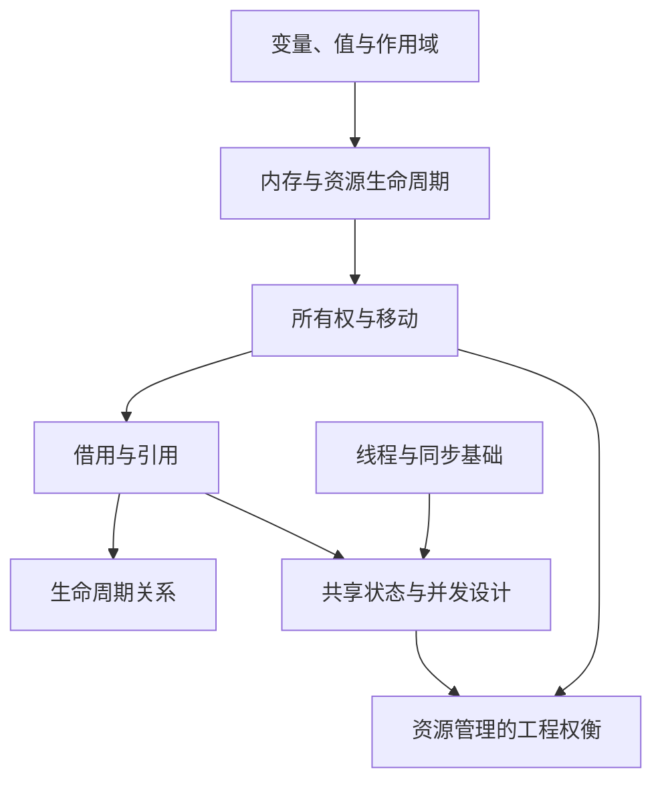
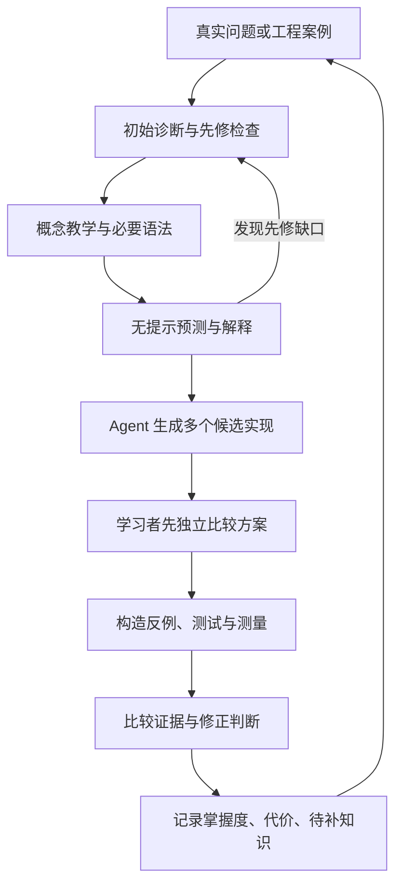
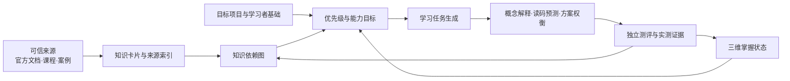

# AI Coding 时代的技术学习体系：研究、方法与试点设计报告

> **版本**：v1.0（讨论整合稿）  
> **整理日期**：2026-11-09  
> **主题范围**：以 Coding Agent 承担主要代码实现为前提，研究如何学习 Rust、Go、React 等技术，并形成工程理解、方案评价与交付能力。  
> **文档性质**：讨论共识、外部调研与待验证设计方案；**不是**已经实证有效的课程，也不是最终产品需求文档。

---

## 摘要

当 Coding Agent 已经可以完成大量代码编写时，学习一门编程语言的主要目标不应继续限定为“熟记语法、独立敲出功能”。但这不意味着语法、基础概念或代码阅读不再重要。恰恰相反：如果学习者不理解所有权、引用、并发、类型、状态等核心概念，就无从评价 AI 方案，也容易把“AI 给出了可信的解释”误认为“自己已经掌握了”。

本报告采用以下渐进目标：**首先成长为能够使用不同技术、独立设计并交付高质量软件的工程负责人；在实际工程中持续深化，逐步成为能够深入理解技术原理的专家。** 在此过程中，能力顺序以“理解概念 → 理解实现 → 评价方案 → 提出改进 → 独立设计”为主，而不是一开始就要求学习者“指导 AI 做出正确的技术选择”。

**学习体系的核心设计**是：以通用计算机知识和具体语言机制为基础，以真实工程问题为载体，显式学习技术的收益、代价、限制与风险；采用有来源的知识图、先修关系、分级掌握标准、最小对照实验与独立测评，形成可反馈、可追溯、可跨技术迁移的学习闭环。

外部调研表明：roadmap.sh、OSSU、Exercism、Google Comprehensive Rust 已能提供相对成熟的知识内容；Guided Learning、Course Skill Graph、qtsone/learning、SkillClimb 提供了螺旋式学习、知识缺口诊断、掌握度关卡等可借鉴设计；MADR 和 Frontend Engineering 提供了工程方案取舍的结构化写法；Brown University、CMU、Colorado School of Mines 已公开将 AI 参与的软件设计、代码评价和验证放入教学的课程实践。但是，**本次检索没有发现一套成熟且经过充分独立验证、可直接实现上述全部目标的开源方案**。因此建议先组合现有资料，以 Rust 开展一个范围受控的学习单元试点，而非直接开发学习平台。

### 本报告回答的问题

1. 在 AI 主导编码的条件下，学习语言或框架的目的是什么？
2. 为什么仍必须学习基础概念？如何确定先修关系与深度？
3. 如何系统建立、检查和更新技术知识地图？
4. 如何训练对技术收益、成本、局限和风险的判断？
5. 学习任务、能力测评和独立验证应该怎样设计？
6. 现有开源项目、大学课程和研究成果有哪些可复用部分、哪些存在缺口？
7. 怎样以最小投入验证整套方法是否有效？

---

## 1. 研究背景、前提与边界

### 1.1 工作方式变化

传统开发语言学习通常采用“语法 → API → 练习题 → 独立开发项目 → 工程实践”的路径，评价标准往往是能否自行写出可运行代码。如今在一个以 Coding Agent 为主要实现者的工作流中，学习者经常承担的是：定义产品目标和约束、比较架构建议、理解 Agent 生成的实现、查找潜在问题、设计测试、判断工程成本、验收并持续维护。

因此，“能写出来”不再足以代表“知道是否应该这样做”。相反，能够得到一份正确编译的程序，也不代表理解其设计或风险。

### 1.2 本报告明确采用的假设

- AI 可以承担绝大部分常规代码生产，但并非始终正确，也不会自动承担使用者对软件质量的最终责任。
- 学习者不追求从零手写大量业务代码，但愿意阅读、修改少量代码、观察运行行为并开展验证实验。
- 目标是跨技术的软件设计与交付能力，而非在短期内成为 Rust 编译器、Go 运行时或 React 协调算法专家。
- 学习资源要支持渐进式深化，并允许根据实际项目改变优先级。
- Rust、Go 是编程语言；**React 是 JavaScript/TypeScript 生态中的 UI 库**。三者不能完全按相同语言维度比较，但可以放入同一套“技术学习框架”。

### 1.3 本报告不主张什么

- **不主张取消语法和 Hello World**：它们可以作为检查环境、理解代码结构的低成本手段，只是不应成为主要学习成果。
- **不主张仅靠 Prompt 学会编程**：会提问、会调用 Agent，不等于具有技术判断能力。
- **不主张初学者立刻指导 AI**：初期应先能够辨别“已知、可疑、尚未验证”，然后逐渐提出更好的设计。
- **不主张一切代码都不需要人工理解**：某些高风险和关键路径，必须有足够深度的理解与验证。
- **不主张某门语言存在绝对优劣**：技术选择是目标、约束、实现质量和成本条件下的判断。

---

## 2. 学习一门语言或技术的目的：能力模型

### 2.1 长期目标

> **第一阶段目标**：能够驾驭不同技术，组织 Coding Agent 完成高质量软件的设计、实现、审查、测试与交付。  
> **持续深化目标**：在真实工程问题中逐步理解语言设计、运行时、编译器、并发与系统机制，成长为技术原理专家。

这不是把程序员简单转变成“代码审查员”。工程负责人不只审查某几行代码，还需要识别需求、质量属性、架构边界、工程风险、团队维护成本和验证盲区。

### 2.2 能力的合理发展顺序

| 阶段 | 核心能力 | 典型可观察表现 | 常见误区 |
|---|---|---|---|
| 01 理解概念 | 知道术语是什么、为什么存在、规则与限制 | 能解释所有权、goroutine、state 等机制，并回答反例 | 只背定义 |
| 02 理解实现 | 看懂关键代码、数据与控制流 | 能预测运行结果、定位关键模块 | 只听懂 AI 的解释 |
| 03 评价方案 | 能比较多个候选方案的收益与代价 | 能在指定约束下给出有依据的评价 | 凭流行度或语言偏好判断 |
| 04 提出改进 | 发现问题后提出可验证的修改 | 指出多余抽象、不必要依赖或潜在故障，说明改法 | 把个人风格等同技术改进 |
| 05 独立设计 | 形成方案并负责验证和交付 | 能定义约束、选型、边界、测试与回退计划 | 认为 AI 生成代码就代表设计正确 |

这些是**成长顺序**，并非严格线性：实际工作中可以在局部领域独立设计，却仍不了解另一个领域的基础。

### 2.3 五类核心能力

1. **概念理解**：机制、定义、适用条件、反例、局限。
2. **工程理解**：代码阅读、模块关系、数据流、运行时行为、依赖和工具链。
3. **方案评价**：正确性、性能、复杂度、可维护性、交付与生态风险。
4. **独立验证**：实验设计、测试、度量、复现、查看官方依据、识别证据不足。
5. **技术设计**：根据问题和约束形成方案，设置验收标准，提出备选与回退。

在这五类能力中，**“方案评价”应先于“提出技术建议”成为训练重点**。初学者可以暂时无法选出最好方案，但应能够指出自己还缺少哪些信息、怎样验证 AI 的观点。

### 2.4 人、Coding Agent 与工具分别负责什么

| 活动 | 人的主要职责 | Agent 可承担的职责 | 独立证据 |
|---|---|---|---|
| 需求与约束 | 确认真实目标、重要质量属性、风险容忍度 | 澄清问题、生成候选规格 | 需求验收清单、真实用户场景 |
| 基础学习 | 解释概念、预测结果、提出质疑 | 教学、示例、追问、生成反例 | 官方资料与运行结果 |
| 技术方案 | 识别比较维度、权衡、审批 | 提出候选架构、优缺点与假设 | ADR、实验、第三方资料 |
| 代码实现 | 审阅关键路径、明确边界 | 编写、重构、生成测试 | 构建、测试、静态分析 |
| 验证与交付 | 决定是否达标、是否承担剩余风险 | 执行测试、收集证据、协助排障 | 复现步骤、测试日志、基准数据 |

**原则**：Agent 可以协助提出、执行、解释和审查，但不能同时成为唯一事实来源、唯一测评者与唯一验收者。

---

## 3. 基础知识仍然必要，但基础的组织方式应改变

### 3.1 从“语法条目”转为“概念与问题”

| 传统切入点 | 更适合的新切入点 | 为什么仍要用到代码 |
|---|---|---|
| 变量如何声明 | 什么是值、状态、作用域、可见性 | 观察变量在不同范围如何变化 |
| 指针和引用语法 | 数据如何被访问、共享、修改，资源由谁管理 | 预测引用是否有效、是否产生错误 |
| 函数与类型声明 | 抽象如何约束输入、输出与非法状态 | 阅读接口和类型检查错误 |
| goroutine / async 的写法 | 并发、并行、异步、取消与背压有何不同 | 构造任务超时与竞态场景 |
| React Hook API | 数据变化如何引起渲染，状态归谁所有 | 追踪重渲染及多余 Effect |
| 单元测试 API | 哪些行为是正确的、哪些失败路径必须覆盖 | 构造自动化的反例和回归用例 |

### 3.2 一个概念应按六个问题学习

每个核心概念至少回答：

1. **是什么**：准确含义，与相近概念有何区别？
2. **为什么存在**：解决了什么具体问题，若没有它会发生什么？
3. **怎样工作**：有哪些核心规则、机制和可观察行为？
4. **代价与限制**：增加了哪些复杂度、开销、约束或失败模式？
5. **什么时候用/不用**：在哪些工程环境有收益，什么时候得不偿失？
6. **如何验证**：什么代码、实验或资料能证明相关判断？

其中第 4、5 项不能只留到“高级专题”。任何核心机制的教学都应包含相应代价和边界，只是早期先讲最直接的部分。

### 3.3 Rust、Go、React 的不同学习重心

| 技术 | 核心机制 | 典型工程判断问题 | 一手材料 |
|---|---|---|---|
| Rust | 所有权、移动与借用、生命周期、类型与 trait、错误处理、并发安全、Cargo | `.clone()` 是否掩盖所有权设计问题？何时需要异步？编译时长和依赖成本是否合适？ | [Rust Book](https://doc.rust-lang.org/book/)、[Reference](https://doc.rust-lang.org/reference/)、[Cargo Book](https://doc.rust-lang.org/cargo/) |
| Go | goroutine、channel、mutex、context、接口、错误传播、GC、工具链 | 会不会泄漏 goroutine？如何取消任务？channel 是否不如 mutex 简单？ | [Go Spec](https://go.dev/ref/spec)、[Go Documentation](https://go.dev/doc/)、[Go FAQ](https://go.dev/doc/faq) |
| React | 声明式组件、state、props、渲染与提交、Effect、数据归属和框架边界 | 是否存在重复状态？Effect 是否多余？组件边界和请求生命周期是否合理？ | [React Learn](https://react.dev/learn)、[You Might Not Need an Effect](https://react.dev/learn/you-might-not-need-an-effect) |

注意：Go 的 [Effective Go](https://go.dev/doc/effective_go) 依然值得读，但官方注明它不是持续更新的全套现代 Go 指南，不能覆盖后来的泛型、模块等重要变化。[R18]

---

## 4. 如何构建学习知识体系

### 4.1 使用三个相互连接的知识层

**通用知识层**：计算机系统、内存与资源、类型、算法与数据结构、操作系统、进程/线程、并发、网络、存储、安全、性能、软件工程、测试、部署。

**技术专项层**：语言与框架的设计哲学、语义规则、标准库、构建工具、运行时、核心生态、常见失误与版本差异。

**工程场景层**：具体产品与业务需求、质量属性、选型、架构权衡、可观测性、基准测试、交付和长期维护。

三层应采用交叉引用：例如“数据竞争”既连接通用并发知识，也连接 Rust 的借用与 Send/Sync、Go 的竞态检测和 React 的异步状态更新场景。但不能把三种技术的完全不同机制等同起来。

### 4.2 知识来源与可信度

| 层级 | 资料类型 | 适用用途 | 局限 |
|---|---|---|---|
| A | 官方语言规范、编译器文档、正式 API、源码、测试 | 确认当前机制和工具行为 | 文档仍可能与具体版本或平台不完全相同 |
| B | 官方课程、CS2023 等知识标准、维护良好的原始项目 | 建立知识覆盖与教学结构 | 不保证适合个人目标 |
| C | 同行评审研究、可复现实验、工程事故报告 | 教学方法或实际风险的证据 | 研究人群与任务不一定可推广 |
| D | 优质博客、论坛、社区经验 | 发现真实问题、候选反例与争议 | 不能仅凭个人经历形成普遍结论 |
| E | AI 总结与推断 | 起草索引、初步归类、生成待查假设 | **不能作为唯一依据** |

可用 CS2023 的 Knowledge Area → Knowledge Unit → Topic → Learning Outcome 结构作为通用覆盖基准，但目标并非照搬整个大学课程。[R01]

### 4.3 以“知识卡片”作为最小内容单元

建议每个核心知识点具有稳定 ID，并包含：

- 定义及范围；来源文献、版本与核验日期。
- 前置知识及其必要性；相关、替代、反例与后继知识。
- 机制与最小演示；至少一个常见误解或错误预测。
- 工程收益、代价、失败模式和适用边界。
- 面向特定项目的优先级 P0/P1/P2。
- 三维能力目标（概念理解、方案评价、独立验证）。
- 练习与测试；自动化部分、人工评审部分、标准答案依据。
- 学习状态、答题证据、复测时间和待补齐的知识缺口。

**知识卡片不是百科全书条目**：一个过大的知识点（如“并发”）应该拆成多个可解释、可测验的单元。

### 4.4 知识依赖图（DAG）

建议对关系分类，而不是把所有连线都写成“必须先学”：

- `requires`：必要前提；没有 A 基本无法理解或应用 B。
- `helps`：有益前提；先学 A 可以降低理解成本，但不是硬阻塞。
- `related`：相近概念，不表示先后。
- `contrasts`：容易混淆的概念或替代机制。
- `applies_to`：从概念指向工程任务、风险、决策。
- `evidenced_by`：指向来源或验证材料。

示意（只展示一部分 Rust 所有权学习关系）：



**如何审查关系**：要求 Agent 给出每条 `requires` 边的教学理由、所依据资料和“若没有该前提，学习者具体在哪个判断上会失败”的例子；通过预备测验或人工复核纠正不可靠边。Course Skill Graph 的设计特别强调找到“课程假设学生懂、实际未教授”的红色节点。[R09]

### 4.5 何谓知识体系“完整”

不要追求覆盖技术所有细节，应区分：

- **目录完整性**：是否遗漏语言基础、工具链、典型故障或核心工程领域？
- **任务充分性**：能否支持预期项目的关键设计、审查和交付？
- **风险充分性**：高后果风险是否有对应的概念、案例和检验手段？
- **先修闭合性**：所有 P0 节点依赖的必要知识是否都已教授或测得已掌握？
- **证据完整性**：关键结论能否追溯来源，实验是否可复现？

可建立“项目场景 × 知识节点 × 风险 × 评测任务”覆盖矩阵；任何高风险行在缺乏概念或检测机制时都应标记为缺口。

---

## 5. 学习优先级与深度：如何做出可解释的选择

### 5.1 不以章节顺序或语法频率决定优先级

对每个知识点评估五个因素：

1. **先修影响**：它阻塞多少重要后续知识？
2. **场景关联**：目标项目是否会用到它？
3. **风险后果**：不了解它可能造成多大故障、安全、数据或维护风险？
4. **迁移价值**：掌握后是否有助于其他语言、框架和系统问题？
5. **学习成本**：需要多大认知与实验投入才能达到目标深度？

推荐先采用专家评审 + 具体任务评估，不急于把五项合成为貌似精确的自动评分。如果要量化，可以先用 1～3 级的**试验性**标度，并保留每项评分的理由。

### 5.2 建议优先级

| 优先级 | 定义 | 学习安排 |
|---|---|---|
| P0 | 重要前置、常用机制，或直接关系严重风险 | 优先学习，并设置独立测验 |
| P1 | 明确有工程价值但不阻塞当前任务 | 在试点场景中逐步覆盖 |
| P2 | 低频、深层内部机制、专业化领域 | 遇到需求或风险再升级 |

例如，为 Rust/Tauri 桌面应用学习 Rust：所有权、Result 错误处理、模块/依赖、异步任务和构建工具通常比 MIR/LLVM 编译流水线内部细节优先；如果正在研究编译性能，编译系统内部则会提升优先级。优先级是“对具体目标的价值”，不是对知识本身价值的绝对评价。

### 5.3 学习深度不等于知识点多少

建议采用两个层面的评价：

**学习阶段（内容深度）**：
- 第 1 轮：建立直觉——是什么、为什么存在、最小例子。
- 第 2 轮：理解机制——规则、边界、常见错误、不同实现。
- 第 3 轮：工程判断——适用条件、代价、替代、实验、争议。

**可证明的能力层级（评测结果）**：
- L1 解释：能准确说清概念、作用与基本限制。
- L2 应用与预测：能阅读关键代码并预测运行或编译行为。
- L3 评价：能结合给定约束比较方案、代价和风险。
- L4 设计：能自行构建解决方案与验证、回退计划。

其中 L1～L4 为本报告提出的操作性量表，不是外部认可的统一认证。对工程负责人路径，**核心知识点以 L3 为重要阶段目标**；少量高风险领域逐渐达到 L4。

---

## 6. 把技术代价、风险和权衡纳入核心课程

### 6.1 为什么不能只学习优势

只知道 Rust 的内存安全、Go 的编译速度、React 的组件模型，容易形成“技术宣传册式知识”。真正的工程选型需要同时考虑要解决的问题和为此支付的代价，包括：

- **正确性与安全**：语言提供哪些静态或运行时保证？保证的边界是什么？
- **开发反馈**：编译、测试、重构、调试的耗时和复杂度。
- **运行开销**：CPU、内存、吞吐、延迟、GC 或运行时成本。
- **构建与分发**：产物体积、缓存与中间文件、跨平台、供应链。
- **系统复杂度**：抽象层级、并发模型、依赖数和可观测性。
- **维护和生态**：库成熟度、版本升级、安全更新、团队/Agent 审查难度。
- **迁移与可逆性**：是否容易替换技术、回退方案、长期锁定成本。

成本不能只等同于性能，也不能只看初次开发快慢；应区分一次性成本、持续成本、故障风险和不可逆代价。

### 6.2 Rust 与 Go 的例子：保留事实、消除绝对化

| 评价维度 | Rust：需要检查 | Go：需要检查 | 不能直接下的结论 |
|---|---|---|---|
| 构建速度 | 首次/增量/优化构建，依赖和泛型开销 | 首次/缓存后/测试构建 | “Rust 一定比 Go 慢多少倍” |
| 构建磁盘 | `target/`、依赖和增量缓存 | Go module/build cache | “最终二进制越小，构建磁盘一定越小” |
| 可执行文件 | profile、LTO、符号信息、链接、依赖 | 默认静态链接、Go 运行时、调试信息 | “Go 的产物必然比 Rust 小” |
| 运行时 | 内存分配、异步执行器、库和系统调用 | GC、调度器、分配与暂停 | “无 GC 就一定整体更快” |
| 资源安全 | 所有权约束、`unsafe` 边界、资源生命周期 | GC 与显式文件/连接关闭 | “有 GC 就没有泄漏风险” |
| 工程效率 | 编译器反馈、类型表达能力、复杂度 | 工具链、接口、并发和错误处理 | “某语言开发成本对所有团队相同” |

依据：Cargo 官方支持 `cargo build --timings` 分析构建关键路径、慢依赖与并行情况；Go 官方 FAQ 明确说明默认的 Go 二进制通常包含运行时，因此简单程序也可能有数 MB。[R16][R17]

### 6.3 技术方案比较记录（Decision Evaluation）

每个重要权衡任务至少记录：

1. **问题与约束**：功能、平台、规模、非功能要求、资源预算。
2. **候选方案**：不少于两个合理选项；可包括“暂不引入新技术”。
3. **收益**：哪些具体能力或风险得到改善？
4. **代价**：构建、运行、实现、维护、学习、部署方面的成本。
5. **失败模式**：最坏情况、发生条件、影响范围与恢复方式。
6. **证据质量**：哪些是官方保证、实测、个案经验或推断？
7. **验证设计**：指标、数据集、对照条件、误差来源、复现方式。
8. **结论与信心**：基于当前条件的选择，仍有哪些未知。
9. **退出条件**：发生什么情况时应重新选型或回退。

这可以直接借鉴 [MADR（Markdown Architectural Decision Records）](https://github.com/adr/madr) 的结构，避免只记“我们选择 Rust”，却没有理由和反对意见。[R12]

### 6.4 一个示例：是否为本地任务处理引入异步运行时

- 需求：本地文件扫描和 SQLite 索引，可能需要取消任务和更新 UI；任务规模尚不确定。
- 方案 A：同步任务 + 后台工作线程；方案 B：异步执行器 + 异步任务；方案 C：混合架构。
- 学习者先回答：任务主要受磁盘、CPU 还是网络影响？哪些步骤可能阻塞？需不需要大量并发 I/O？取消语义怎样定义？
- 代价：依赖与构建成本、执行路径复杂度、调试与取消、数据库库的阻塞行为。
- 实验：相同数据集测量吞吐、峰值内存、任务取消延迟、构建时长和失败恢复。
- 决策：允许“简单同步实现更适合现阶段”成为正确结论；不能把“采用更先进的异步”直接当作高分答案。

---

## 7. 面向 Coding Agent 的学习过程

### 7.1 一个完整的学习循环



对初学者，C 阶段可以给出清晰解释和示例；在 F 阶段要逐渐减少 AI 的提示，防止评价任务变成“复述 Agent 的观点”。

### 7.2 一次学习单元的四种练习

| 练习 | 学习者做什么 | Agent 做什么 | 评价方式 |
|---|---|---|---|
| 概念解释 | 不看答案解释“是什么/为什么/限制” | 追问、给反例 | 概念是否准确，能否纠正混淆 |
| 代码预测 | 阅读少量代码，预测编译或运行 | 提供代码与变体 | 实际编译、运行和输出 |
| 方案比较 | 评价两个以上候选方案 | 生成方案、补充证据 | 依据是否支持结论、是否识别权衡 |
| 实验验证 | 事先给出假设和验证标准 | 实现测试、收集数据 | 独立日志、可复现度、结论限制 |

少量手动编码可用于构造实验、理解编译器错误，并非主要产能要求；不能把“完全不碰代码”设为教学成就。

### 7.3 逐步撤除 AI 帮助

- **学习初期**：允许教师型 Agent 讲清概念、解释错误和提供正确例子。
- **形成基础后**：优先提供提示、对照问题和官方来源，而不是结论。
- **评测时**：独立提交答案、信心和证据请求，再允许 Agent 反馈。
- **复测时**：使用未见过的代码或场景，观察是否真正迁移。

允许明确回答“不知道”，但应进一步说明哪部分不确定、哪些资料或实验可以消除不确定性。

### 7.4 多重 Agent 的合理角色边界

可在同一个 Agent 内切换角色，而不是立刻建设复杂多 Agent 系统：

- **Tutor**：教授概念、检查先修、追问原因。
- **Implementer**：根据规格生成多种实现及测试。
- **Challenger**：提出反例、质疑隐含假设、寻找不适用场景。
- **Evaluator**：依预先公布的评价量表反馈，但不掌握隐藏测试的全部答案生成权限。
- **Evidence Curator**：引用官方资料并记录版本与测量条件。

**关键是评价流程隔离，而不是角色数量**。同一模型在看到标准答案后给分，或者自行生成题目并自行宣称通过，存在明显的自证偏差。

---

## 8. 如何客观评估“学会了没有”

### 8.1 三维掌握度，而非一个总分

| 维度 | 要求 | 适合的证据 |
|---|---|---|
| **C：概念理解** | 定义、规则、机制与限制 | 解释、反例、预测、概念纠错 |
| **J：工程评价** | 在约束下比较收益/代价/风险 | 匿名候选方案分析、ADR、风险判断 |
| **V：独立验证** | 提出可证伪假设并完成检验 | 预先登记的测试计划、运行日志、实测数据 |

每个知识点分别记录 `C-L1~L4`、`J-L1~L4`、`V-L1~L4`（不适用项标记 N/A）。不要靠平均分掩盖某个薄弱维度。例如 `C-L3 / J-L1 / V-L1` 不能解释为“平均达到 L2”。

### 8.2 四级表现描述

| 级别 | C：概念理解 | J：工程评价 | V：独立验证 |
|---|---|---|---|
| L1 | 识别并准确解释基本概念 | 识别明显收益和成本类别 | 识别应检查哪些结果 |
| L2 | 预测典型代码与机制行为 | 在明确约束下比较两个简单方案 | 运行现有测试、解释失败结果 |
| L3 | 解释边界、反例与常见误区 | 形成证据支持的权衡与风险评价 | 设计并执行能区分方案的实验 |
| L4 | 将概念迁移到陌生复杂场景 | 提出合理新方案、退出条件与回退 | 识别测量偏差，设计可复现的综合验证 |

这是试点量表，应通过实际任务不断校准，不能把它宣传为经过验证的标准化测验。

### 8.3 测评结构

1. **入门诊断**：测出已经掌握的基础；避免重复上课。
2. **即时理解测验**：在教学后独立预测行为和诊断错误。
3. **迁移测验**：使用没有在教学中出现过的代码、情境和语言变体。
4. **延迟复测**：建议在一至数周后复测关键知识，不只记录当日表现。
5. **信心校准**：回答前记录信心，检查“高信心但错误”的盲区。
6. **工程评价报告**：不仅看最后选了什么，更看约束、证据、反例与实验设计。

Anthropic 2026 年对 52 名参与者开展的短期随机实验中，AI 辅助组在任务后测验中平均 50%，人工编码组平均 67%；研究重点关注代码阅读、调试及概念理解。该研究支持对“AI 帮助完成 ≠ 学会”的警惕，但样本、任务和时长有限，不能直接推断长期教育效果。[R02]

### 8.4 正确答案不能总是唯一方案

对于行为确定的测试，可以有客观预期（编译能否通过、执行输出、测试是否失败）。对于架构评价，则可能存在多个合理方案。应采用**准则评分**：

- 是否明确用户目标和约束。
- 是否发现关键风险与失败路径。
- 是否至少识别一种合理替代方案。
- 是否区分事实、实测、推断和未知。
- 是否安排了真正能改变决策的实验。
- 是否对结论的适用范围保持克制。

对架构题，不能仅以“与教师偏好的技术一致”判定通过。

---

## 9. 外部研究与开源项目：对照分析

### 9.1 项目选择与核验方式

重点查看项目源仓库、官方课程页、README、许可和可访问文档。评价维度包括：是否可运行、是否有实际内容、先修知识支持、学习状态、测评机制、技术取舍内容、许可和社区验证。

**注意**：项目 README 反映的是作者声明，不等于独立复现实测。Star 数和计划章节数量只能作为辅助线索；本报告不将其作为质量分数。

### 9.2 现成知识体系

| 项目 | 已有价值 | 不足/限制 | 推荐用途 |
|---|---|---|---|
| [roadmap.sh](https://roadmap.sh/) · [源码](https://github.com/nilbuild/developer-roadmap) | 多种技术路线、学习资源和概念目录 | 不以工程取舍和独立掌握证据为核心；平台与内容许可须分别核查 | **知识目录与路线参考** |
| [OSSU Computer Science](https://github.com/ossu/computer-science) | 通用计算机科学覆盖广，先修课程关系明确 | 完整学位式路径投入过大 | **通用知识覆盖检查** |
| [Exercism](https://exercism.org/) · [Concept 文档](https://github.com/exercism/docs/blob/main/building/tracks/concepts.md) | 概念、练习、先修的结构化组织 | 多以代码训练为核心 | **知识卡片与练习数据模型** |
| [Google Comprehensive Rust](https://github.com/google/comprehensive-rust) | Rust 专题内容、课程与教师资源 | 更适合已有经验工程师，课堂讨论不可完全复刻 | **Rust 一手教学内容** |
| [Rustlings](https://github.com/rust-lang/rustlings) | 小型练习便于预测和验证规则 | 不覆盖完整架构权衡 | **最小代码实验** |

Exercism 文档明确把 Concept Exercises 与知识点、先修知识及练习关联，可直接借鉴其组织思路。[R06] Google Comprehensive Rust 说明它由 Google Android 团队开发，并特别提醒课堂教学与自学体验不同。[R07]

### 9.3 AI 学习引擎与知识图

| 项目 | 关键设计 | 复用价值 | 成熟度提醒 |
|---|---|---|---|
| [qtsone/learning](https://github.com/qtsone/learning) | 课程文件版本化、Go 主线、Agent Tutor、测验与严格通过关卡 | 学习状态、课程脚手架、可测试单元 | Go 可用，Python 只是占位；AGPL-3.0 需核对使用场景 |
| [Guided Learning Skill](https://github.com/WSE-research/guided-learning-skill) | 三轮螺旋学习、间隔复习、理解检测、Markdown 知识库 | 渐进深度、轻量 Agent 教学 | 项目较小，教学效果需自测 |
| [SkillClimb](https://github.com/danallison/skillclimb) | 先测后教、技能树、自适应测评、间隔重复 | 个性化补课、信心校准 | 当前以网络安全技能树为主，社区验证有限 |
| [Course Skill Graph](https://github.com/mprokopov/teaching-skills/tree/main/course-skill-graph) | 寻找未教授的隐含前提，生成准备度测试 | 审查知识图与先修关系 | 主要是课程审计 Skill，不是完整 LMS |
| [Adaptive Learning Path System](https://github.com/ScarletHollow/Adaptive-Learning-Path-System) | 从目标/PDF 形成技能图，诊断缺口并有限修复 | 动态依赖图和补救学习 | 研究原型；本次未确认清晰的仓库许可，复用前需核对 |

**特别注意两个差异**：

- qtsone/learning 的“必须写代码并通过审查才算掌握”未完全匹配本报告的人机分工，应改成读码、预测、评价和验证的综合关卡。[R08]
- Course Skill Graph 明确要求知识节点来自真实课程和测验，不得由 Agent 凭题目想象；其作者公开承认首次识别的某些前置缺口存在误判。[R09]

### 9.4 工程判断知识与决策模板

| 项目 | 提供的能力 | 需要改造的部分 |
|---|---|---|
| [Frontend Engineering](https://github.com/ualiyou/frontend-engineering) | 按工程决策、取舍、反模式组织知识，含带类型的知识关联、角色路径、技术与编辑双审查 | 与学习者掌握度、独立测评结合 |
| [MADR](https://github.com/adr/madr) | 标准化记录约束、候选、利弊、选择与后果 | 为教学增加评分标准、反例、实验与信心记录 |
| [Engineering Handbook](https://github.com/handbook-academy/engineering-handbook) | 系统设计与实践知识整理框架 | 对内容的准确性、版本、覆盖范围逐篇复核 |

Frontend Engineering 的 ARTICLE_INVENTORY 在检索时写明规划 651 篇、其中 94 篇标注 Published、557 篇 Planned；其 README 另有“45 篇已开放”的文字，反映公开介绍和内部清单可能不同步。不能把 651 篇规划量当作 651 篇已完成课程，也不能仅凭 Published 标记认定全部经过独立同行评审。[R11]

### 9.5 高校公开课程与研究

| 来源 | 关键做法 | 启发 | 限制 |
|---|---|---|---|
| [Brown CSCI 0111E（2026 秋）](https://cs.brown.edu/courses/csci0111e/fall26/course-design.html) | 从规格、对照实现、代码审查、测试和口头解释训练理解 | 早期就让学生评价 Agent 产物 | 仍包含手工编程，课程处于试点 |
| [CMU 06-643（2026 春）](https://kitchingroup.cheme.cmu.edu/s26-06643/syllabus.html) | AI 协作开发、测试、调试、性能、CI/CD、发行 | 将交付能力与代码评价一起教学 | 特定于科研软件和 Python |
| [Colorado School of Mines（2026 秋）](https://mines-coding-with-ai-agents.github.io/course/curriculum/) | Agent 基础、上下文、工具、架构、评测和安全 | 练习失败复现、测量与评测设计 | 学期仍在进行；评测模块尚属后续安排 |
| [Anthropic 研究（2026）](https://www.anthropic.com/research/AI-assistance-coding-skills) | 对比 AI 辅助与手工实现的短期理解效果 | 独立理解测验必不可少 | 不能由短期小样本推导普遍长期结论 |

### 9.6 总体可复用性判断

- **适合直接采用**：官方资料、Rustlings 最小练习、MADR 记录结构、现有知识目录参考。
- **适合借鉴并轻改**：Guided Learning 的三轮学习、Exercism 的概念/练习关系、Course Skill Graph 的缺口审计。
- **适合做设计参考，不宜立即依赖**：新兴自适应学习系统的宣称能力、复杂课程引擎及无明确许可的原型。
- **本次未发现成熟完整替代品**：将语言基础、工程成本与风险、AI 代码审查、个体掌握证明同时纳入同一闭环的开源方案。

---

## 10. 相对于原先设想，新增的关键设计约束

1. **知识图会误判**：必须记录来源、边类型、审查状态，不能把自动生成的图当作真理。
2. **项目完成不等于学习完成**：需要与 Agent 分离的独立测验。
3. **学习应逐步撤除帮助**：从解释到提示，再到独立判断和延迟复测。
4. **技术决策存在多解**：训练的是基于约束的论证，不是猜老师喜欢哪个语言。
5. **学习者需要识别未知**：能说出还缺什么证据，比自信地选错更有价值。
6. **不仅要测即时成绩**：还要考察迁移、遗忘和高信心错误。
7. **外部教程会过时**：需要版本标记、链接检查、复核时间和更新日志。
8. **评价方案的成本也要计算**：如果实验过重、收益不明确，应选择更便宜的鉴别实验。
9. **评测不可过度自动化**：编译器能判规则，架构权衡通常需专家规则与证据复核。
10. **学习系统应允许“跳过”**：入门测验能证明掌握的知识，无需重复学习。

---

## 11. 推荐的学习体系架构（方法设计，不是产品架构）



### 建议采用的最小技术形态

- **知识与学习记录**：Markdown + YAML frontmatter，存储在本地 Git 仓库。
- **关系数据**：初期用 YAML/JSON 列表描述节点与边；只有复杂度真正增加时再使用图数据库。
- **教学方式**：现有 Coding Agent + 一个明确的 Tutor Skill，按阶段读取相应内容。
- **验证**：本地编译器、测试、静态检查、时间和资源测量；保留标准输出与环境清单。
- **评价**：结构化 Rubric + 独立题库 + 人工复核，先不构建复杂自动评分平台。
- **可视化**：后续按需导出 Mermaid/HTML 知识图；不要把 UI 工程作为验证学习方法的前提。

这样可以优先测试教育方法，不让平台开发消耗主要精力。

---

## 12. 两个 Rust 试点学习单元

### 单元 A：所有权与资源管理（概念型）

**核心问题**：Rust 如何确定资源的使用和释放规则？什么时候所有权或借用约束是收益，什么时候会增加实现复杂度？

**必要先修**：变量与值、作用域、栈和堆的基本区别、引用、资源生命周期。先修诊断没有通过时只补缺口，不必开设完整计算机体系课。

**学习内容**：

1. 区分值、引用和所有权；理解移动与借用。
2. 解释为什么某些代码无法通过编译，以及错误的保护目标是什么。
3. 比较不同实现：移动所有权、借用、克隆、引用计数、共享可变状态。
4. 识别 `.clone()` 的两面性：有时是合理的所有权选择，有时隐藏多余分配或不清晰的数据归属。
5. 评价“简单实现”“额外复制”“结构重设计”之间的成本。

**四项练习**：

- 概念解释：说明所有权、借用和生命周期的关系，澄清所有权不等于“所有值都只能有一个引用”。
- 代码预测：在没运行前判断若干小代码片段能否编译，指出关键规则。
- 方案比较：阅读 Agent 提供的三个实现；不要先看 Agent 的推荐排序，独立记录收益与代价。
- 实验验证：运行编译器并测量相关性能或分配；解释实验不能证明什么。

**通过条件（试验性）**：能够对新的所有权情境做出正确规则预测；能够准确区分至少两种设计的资源和复杂度代价；对无法验证的性能判断明确提出需要什么实验。具体分数阈值待通过试点校准。

**主要来源**：[Rust Book：Ownership](https://doc.rust-lang.org/book/ch04-01-what-is-ownership.html)、[References and Borrowing](https://doc.rust-lang.org/book/ch04-02-references-and-borrowing.html)。

### 单元 B：Rust 与 Go 的构建/运行成本（权衡型）

**核心问题**：在同样目标下，Rust 和 Go 的编译反馈、构建磁盘、可执行文件、运行资源及维护成本有哪些差异？这些差异会改变选型吗？

**项目规格**：一个功能等价的本地文件索引 CLI，扫描给定目录、计算可重复的文件元数据、写 SQLite、处理权限错误与任务中断。**必须先冻结功能和验收标准，之后才允许生成两份实现**。

**测量清单**：

| 项目 | 具体指标 | 控制变量 |
|---|---|---|
| 冷启动构建 | 首次构建耗时 | 工具链版本、缓存状态、依赖下载是否计时 |
| 增量构建 | 小改动后构建耗时 | 固定修改类型、相同构建配置 |
| 产物体积 | 二进制实际字节数 | 发布/调试配置、符号信息、链接方式 |
| 构建磁盘 | 工作目录、依赖/缓存占用 | 明确统计哪些目录 |
| 运行时间 | 同一数据集的处理耗时 | 硬件、文件缓存、工作负载、重复次数 |
| 内存资源 | 峰值 RSS、必要时分配次数 | 平台、采样方法、输入规模 |
| 可靠性 | 权限失败、损坏、取消、恢复 | 统一错误样本与可观察预期 |
| 工程代价 | 依赖数、复杂度、调试与部署步骤 | 尽量采用可审计的代理指标，并注明主观性 |

**实验规则**：

- 至少重复测量，并分别记录冷缓存与热缓存条件；不要只留下一个最优数字。
- 先明确是否需要网络、并发 I/O、GC 可接受程度、目标平台和分发要求。
- 允许不同语言采用其惯用实现，但必须保证功能等价；“逐行翻译”可能造成不公平比较。
- 不把某次结果推广为跨所有项目的语言定律。
- 对最重要的结论注明适用条件，并保留原始结果与运行脚本。

**工具与资料**：`cargo build --timings`、`go test`、`go test -race`（仅检测运行期间触发的竞态），平台命令如 `/usr/bin/time`，以及官方编译选项文档。[R16][R17]

**最终输出**：一份只针对当前项目约束的对比 ADR；包含所选方案、证据、反对意见、未验证风险和重新评估条件。

---

## 13. 可直接复用的文档模板

### 13.1 知识卡片 frontmatter（建议字段）

```yaml
id: rust.ownership.core
name: Rust 所有权
technology: rust
category: language-semantics
status: draft                 # draft / reviewed / verified
priority: P0                  # 随学习目标变化
learning_pass: 1              # 1 直觉 / 2 机制 / 3 工程判断
prerequisites:
  required:
    - cs.values-and-scope
    - cs.resource-lifetime
  helpful:
    - cs.stack-and-heap
relations:
  contrasts:
    - go.garbage-collection
  applies_to:
    - scenario.local-file-indexing
competency_targets:
  concept: L3
  judgment: L2
  verification: L2
sources:
  - title: The Rust Programming Language: Ownership
    url: https://doc.rust-lang.org/book/ch04-01-what-is-ownership.html
    source_type: official
    verified_on: 2026-11-09
review:
  reviewed_by: null
  reviewed_on: null
```

正文建议固定章节：定义、先修、解决的问题、核心机制、最小代码、收益、代价、误区、工程场景、反例、验证、开放问题。

### 13.2 工程决策练习模板

```markdown
# 工程决策练习：<问题>

## 1. 需求与约束
- 功能目标：
- 非功能要求（性能、可靠性、安全、部署）：
- 不可变约束 / 可调整约束：

## 2. 候选方案
- A：
- B：
- C（可选，包含“不引入新机制”）：

## 3. 先独立判断（在查看 AI 推荐之前完成）
- 我当前的选择与理由：
- 每种方案的收益：
- 每种方案的成本与风险：
- 我缺少哪些证据：
- 当前判断信心：低 / 中 / 高

## 4. 证据与实验
- 官方依据及版本：
- 反例或失败条件：
- 测量指标、输入、环境和重复次数：
- 原始输出与复现方式：

## 5. 结论
- 在当前约束下选择：
- 没有选择其他方案的理由：
- 仍然未知的事项：
- 触发重新评估或回退的条件：

## 6. 独立评价
- 概念理解：
- 方案评价：
- 验证能力：
- 需要补学的知识：
```

### 13.3 单个评测任务至少要记录的内容

- `task_id`、版本与测评目标；
- 题目涉及的知识点、前置条件及目标能力层级；
- 未见过的新情境或变体；
- 预期答案、可接受的替代答案和判分理由；
- 是否允许查官方文档、是否允许使用 Agent；
- 自动化证据与人工复核要求；
- 学习者答案、时间、信心、自我纠错及复测结果。

如果题目是开放性架构评价，标准答案应是**评价准则与必要证据**，不能只写“正确选择 Rust”。

---

## 14. 最小可行验证计划（POC）

### 14.1 核心待验证假设

**H1：** 与以语法覆盖和手写练习为主的个人学习方式相比，概念—评价—验证式训练能更直接提升陌生工程方案的分析能力。  
**H2：** 在不以大量手写业务代码为训练目标的情况下，学习者仍能形成必要的代码阅读、调试和机制理解能力。  
**H3：** 引入技术代价与证据记录，可以减少无依据的技术偏好和过度自信。  
**H4：** 显式先修图与初始诊断能够减少无效重复学习和卡住时的盲目解释。

这些是假设，不是现有资料已经证明的结论。

### 14.2 建议实施顺序

| 阶段 | 工作 | 可验收产物 | 停止/调整信号 |
|---|---|---|---|
| 0. 基线 | 对 Rust 概念和工程判断做初测 | 基线答案、信心、缺口记录 | 题目已泄漏或与真实目标无关 |
| 1. 知识样本 | 为两个试点单元建 10～20 个核心节点及先修边 | 带来源的卡片、知识关系、待核验项 | 大量依赖边无可解释依据 |
| 2. 教学单元 A | 运行所有权概念学习与新情境预测 | 解释、代码预测、反例结果 | 仅能复述而不能预测新代码 |
| 3. 教学单元 B | 运行 Rust/Go 对照实验与 ADR | 基准数据、风险分析、决策记录 | 实现功能不等价或测量不可复现 |
| 4. 独立评价 | 隐藏测试、无 Agent 评价、迁移任务 | C/J/V 分维结果、盲区清单 | AI 直接提供标准答案造成污染 |
| 5. 延迟复测 | 用新问题复测并修订地图 | 保留率、错误类别、下一轮计划 | 表现只存在于课堂情境，不能迁移 |

每个阶段应有可供独立检查的具体文件或日志，而不是仅有 Agent 的自然语言总结。

### 14.3 推荐的评估设计

- **最小个人试验**：学习前后分别做不同但难度接近的任务；记录是否从“知道术语”进步到“能够解释并验证判断”。这种试验只能支持个人改进，不能宣称方法具有普遍因果效果。
- **更强的对照**：若有条件，让多位学习者在相同前测基础上比较传统路径与新路径，交叉使用不同主题并尽量统一题目难度和时长。
- **复测与迁移**：使用未见过的 Rust 代码、另一种工程场景，以及适当的 Go/React 对照问题，观察是否真正获得跨情境能力。
- **判分隔离**：Agent 可以协助生成题库，但应由人审核隐藏题和 Rubric；运行结果必须可外部检查。

### 14.4 POC 成功应意味着什么

建议以**可观察的改进**而非课程完成数量判断：

- 能正确解释并预测此前不会的关键机制。
- 能在两个“都能运行”的实现之间，识别有实际影响的成本和风险。
- 能提出改变结论所必需的资料或实验，而不是要求 AI 再表态一次。
- 能保留可复现的证据，在新的任务上给出合理判断。
- 延迟复测没有完全退化为依赖 AI 提示。

是否达到这些目标，要看实际记录，不能在试点前预设成功。

---

## 15. 风险、局限与保障措施

| 风险 | 表现 | 控制措施 |
|---|---|---|
| 伪理解 | AI 解释清楚，但学习者不能独立应用 | 预测、未见过的新题、延迟复测 |
| 自动知识图幻觉 | 依赖关系看似精美却不符合学习事实 | 官方来源、必要/有益区分、人工抽审、先修测验 |
| 技术偏见 | 只列优势，不量化或核实代价 | 候选方案、反对意见、风险与证据模板 |
| 基准不公 | 两个语言程序功能或配置不同 | 冻结规格、环境记录、重复实验 |
| 过度依赖 Agent | 学习者不会阅读关键代码或诊断问题 | 逐步撤除提示、定期无 Agent 测评 |
| LLM 评分漂移 | 同一答案被不同措辞的 AI 评分为不同结果 | Rubric、隐藏题、自动化证据和人工抽审 |
| 技术材料过时 | API、工具、惯用法和最佳实践已改变 | 版本、核验日期、链接与变更检查 |
| 学习平台过度建设 | 花大量时间开发 UI，却无法证实学习效果 | Markdown + Git + 单一 Skill 起步 |
| 许可证问题 | 误以为公开 GitHub 仓库可任意复制 | 核对 LICENSE、内容许可、署名与协议义务 |
| 高风险场景失控 | AI 生成代码被部署到生产环境却未充分验证 | 最小权限、真实数据隔离、测试和人工批准门禁 |

---

## 16. 研究结论与后续决策建议

### 16.1 已有较充分依据的判断

- 2026 年已有大学课程探索把规格设计、Agent 协作、代码审查和质量验证纳入开发教学；说明该教育方向并非孤立设想。[R03][R04][R05]
- 技术知识图、先修关系、自适应测评、间隔复习、课程脚手架和工程决策记录已分别存在可研究的开源实现。[R06][R08][R09][R10][R12]
- AI 辅助完成任务不能被直接等同于学习成效；需要独立的理解、调试和代码阅读评价。[R02]
- Rust 与 Go 的实际资源/构建成本依赖配置和任务，不能以“某语言产物必然更小”作为未经验证的通用知识。[R16][R17]

### 16.2 本报告提出但仍待验证的判断

- 面向 Coding Agent 开发者，主要以理解—方案评价—验证组织课程，可能比单纯语法覆盖更贴近工程负责人目标。
- 三维掌握度（概念、评价、验证）比单一“完成章节”更能反映实际能力缺口。
- 明确教授技术缺点、成本和反例，可能改善选型质量与信心校准。
- 不必从零开发新的 LMS；小规模的 Markdown 知识库和 Agent Skill 足以开始验证方法。

### 16.3 推荐的执行决策

**先做学习方法试点，不做学习平台。**

优先借鉴已有知识源的组织方式、Course Skill Graph 的先修审计、Guided Learning 的分层教学和 MADR 的权衡模板；通过 Rust 所有权与 Rust/Go 构建成本两个互补单元，测试学习者是否能从“概念一知半解”成长到“有证据地评价 AI 方案”。

若试点证明有效，再逐步形成 Rust、Go、React 共用的**技术知识卡片规范、工程判断练习规范、三维掌握度评价规范**，最终才考虑自适应学习产品或可视化知识系统。

> **最终原则**：学习体系应以可信知识为基础，以真实问题为驱动，以技术收益和代价并重，以独立判断及可验证证据为成果；AI 是学习和实现的工具，不是事实与正确性的最终裁判。

---

## 参考资料与来源索引

> 以下优先列出官方文档、项目原始仓库、课程官网和研究原文；部分项目功能来自作者公开说明，未在本报告中完成安装和端到端复现实验。链接与仓库状态核验时间为 2026-11-09；后续复用应再次核验版本和许可证。

### A. 知识标准与技术一手文档

- **[R01]** ACM/IEEE-CS/AAAI，*CS2023 Curricula*：[官网](https://csed.acm.org/)；[Knowledge Areas](https://csed.acm.org/knowledge-areas/)。知识区域、知识单元和学习成果的结构参考。
- **[R16]** Rust Cargo Book，*Reporting build timings*：[官方文档](https://doc.rust-lang.org/stable/cargo/reference/timings.html)。用于验证构建耗时和慢依赖。
- **[R17]** Go 官方，*Frequently Asked Questions*：[Go FAQ](https://go.dev/doc/faq)。用于确认 Go 默认二进制、运行时和调试信息的说明。
- **[R18]** Go 官方，*Effective Go*：[官方文档](https://go.dev/doc/effective_go)。官方注明该文档不持续更新全部现代 Go 特性。
- Rust 项目：[The Rust Programming Language](https://doc.rust-lang.org/book/)；[Rust Reference](https://doc.rust-lang.org/reference/)；[Cargo Book](https://doc.rust-lang.org/cargo/)。
- Go 项目：[Go Specification](https://go.dev/ref/spec)；[Go Documentation](https://go.dev/doc/)。
- React 官方：[Learn React](https://react.dev/learn)；[You Might Not Need an Effect](https://react.dev/learn/you-might-not-need-an-effect)。

### B. 学习科学、大学课程与 AI 协作

- **[R02]** Anthropic（2026-01-29），*How AI assistance impacts the formation of coding skills*：[研究原文](https://www.anthropic.com/research/AI-assistance-coding-skills)。短期随机对照实验，讨论 AI 对概念、阅读和调试测验的影响。
- **[R03]** Brown University，*CSCI 0111E — Course Design*（Fall 2026）：[课程设计](https://cs.brown.edu/courses/csci0111e/fall26/course-design.html)。程序规格、比较、代码审查与 Agent 协作的试点教学。
- **[R04]** Carnegie Mellon University，*06-643: Scientific Software Engineering with AI Coding Agents*（Spring 2026）：[Syllabus](https://kitchingroup.cheme.cmu.edu/s26-06643/syllabus.html)。AI 协助的工程交付、测试与调试课程。
- **[R05]** Colorado School of Mines，*Coding with AI Agents*（Fall 2026）：[Curriculum](https://mines-coding-with-ai-agents.github.io/course/curriculum/)。Agent 开发、评测与安全课程框架。

### C. 开源知识地图、课程与练习

- roadmap.sh：[官网](https://roadmap.sh/)；[仓库](https://github.com/nilbuild/developer-roadmap)。开发者路线与知识目录。
- OSSU：[Computer Science](https://github.com/ossu/computer-science)。计算机科学课程覆盖与先修关系。
- **[R06]** Exercism：[Concepts 结构](https://github.com/exercism/docs/blob/main/building/tracks/concepts.md)；[Concept Exercises 结构](https://github.com/exercism/docs/blob/main/building/tracks/concept-exercises.md)。
- **[R07]** Google：[Comprehensive Rust](https://github.com/google/comprehensive-rust)；[课程网站](https://google.github.io/comprehensive-rust/)。
- Rust 官方：[Rustlings](https://github.com/rust-lang/rustlings)。适合最小代码行为测试。

### D. AI 导师与自适应学习

- **[R08]** qtsone，*learning / tutor*：[GitHub](https://github.com/qtsone/learning)。课程图、Go 课程、掌握度关卡及 Agent Tutor；AGPL-3.0。
- Guided Learning Skill：[GitHub](https://github.com/WSE-research/guided-learning-skill)。螺旋式学习、间隔复习、理解检查。
- **[R09]** mprokopov，*Course Skill Graph*：[GitHub](https://github.com/mprokopov/teaching-skills/tree/main/course-skill-graph)。先修知识缺口和准备度检查。
- **[R10]** danallison，*SkillClimb*：[GitHub](https://github.com/danallison/skillclimb)。自适应评估、间隔重复、技能树。
- ScarletHollow，*Adaptive Learning Path System*：[GitHub](https://github.com/ScarletHollow/Adaptive-Learning-Path-System)。研究原型；重用前确认许可证与有效实现。

### E. 工程取舍与决策记录

- **[R11]** ualiyou，*Frontend Engineering*：[GitHub](https://github.com/ualiyou/frontend-engineering)；[Article Inventory](https://github.com/ualiyou/frontend-engineering/blob/main/ARTICLE_INVENTORY.md)；[Standards](https://github.com/ualiyou/frontend-engineering/tree/main/standards)。以工程决策、成本与反模式组织内容。
- **[R12]** adr，*MADR — Markdown Architectural Decision Records*：[GitHub](https://github.com/adr/madr)；[官网](https://adr.github.io/madr/)。结构化记录技术取舍。
- handbook-academy，*Engineering Handbook*：[GitHub](https://github.com/handbook-academy/engineering-handbook)。系统设计与工程实践内容参考。

---

**附注：证据解释原则**：本报告中的“发现项目存在某项功能”，有时意味着仓库当前公开文档**声明**存在该功能，而非本次已下载运行并复现。尤其是小型项目，不应把 README、Star 数或课程规划直接等同于稳定性、教学有效性或可商用许可。对引用内容的复用，应逐项确认版本、许可和实际效果。
